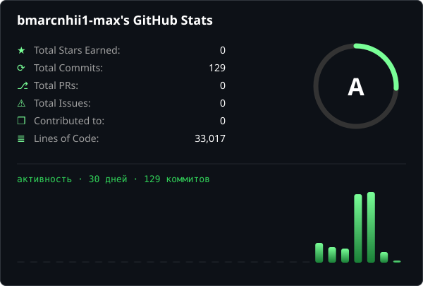
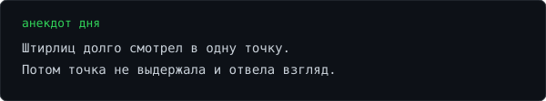

---

### 📦 Репозитории

| Репозиторий | Что внутри |
|---|---|
| [scrcpybar](https://github.com/bmarcnhii1-max/scrcpybar) | Музыка с телефона в Game Bar на ПК: виджет, SMTC, караоке-слова. Только USB, один exe. `C# · Kotlin` |
| [clawd-android](https://github.com/bmarcnhii1-max/clawd-android) | Android-клиент. `Kotlin` |
| [clawd-botik](https://github.com/bmarcnhii1-max/clawd-botik) | Клиент Clawd для Windows. `Python` |
| [vlc-gamebar-widget](https://github.com/bmarcnhii1-max/vlc-gamebar-widget) | Пульт VLC в Game Bar: скорость, перемотка, громкость, плейлист, установщик в один клик. `C#` |
| [sticker-userbot](https://github.com/bmarcnhii1-max/sticker-userbot) | Юзербот для стикеров в Telegram. `Python` |

### 📌 Закреп

### 📊 Статистика

